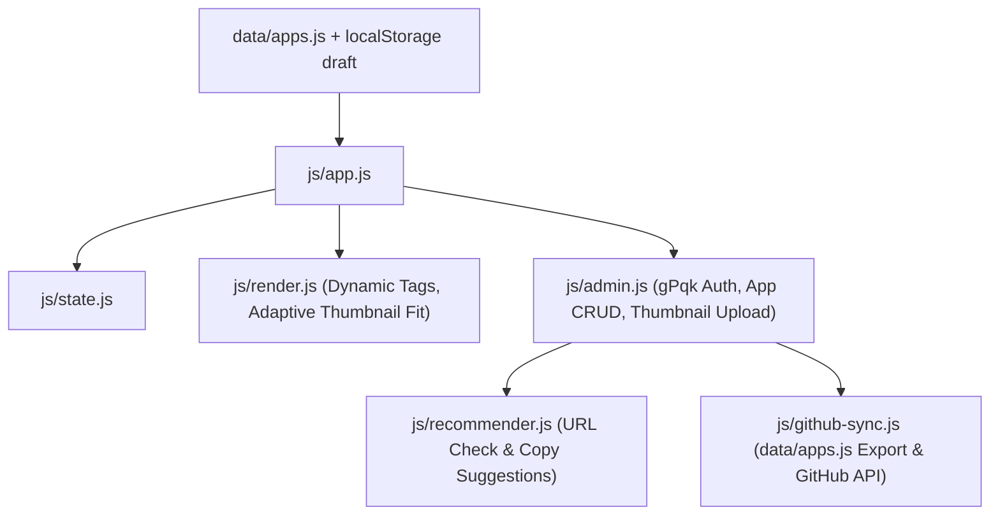

# 윤선생 App Studio 브랜딩 · 카테고리 정리 · 관리자 모드 구현 계획

> **For agentic workers:** REQUIRED SUB-SKILL: Use superpowers:subagent-driven-development to implement this plan task-by-task. Steps use checkbox (`- [ ]`) syntax for tracking.

**Goal:** Rebrand the portfolio to **윤선생 App Studio** (`교육용 및 일상생활을 위한 웹앱 공유 플랫폼`), remove unused sample categories/entries so only categories actually assigned to registered apps appear, and add a `gPqk`-protected Admin Mode in the header with URL inspection & content recommendations, adaptive multi-size thumbnail fitting, local preview, `data/apps.js` download, and GitHub Contents API auto-publishing.

**Architecture:** Extend the existing zero-build `<script defer>` IIFE architecture with three focused modules—`js/recommender.js` (pure-JS SHA-256 helper? No, keep auth & sync cleanly separated: `js/recommender.js` for URL inspection & Korean copy suggestions, `js/github-sync.js` for `data/apps.js` serialization & GitHub Contents API commits, and `js/admin.js` for `gPqk` SHA-256 auth, admin modal UI, thumbnail upload/fit preview, and CRUD wiring)—while upgrading `data/apps.js`, `js/render.js`, `js/app.js`, `index.html`, and `css/styles.css`.

**Architecture Diagram:**

**Tech Stack:** HTML5, CSS3, Vanilla JS (zero external dependencies, `file://` & subpath compatible), `node:test` + `node:assert/strict`, Python `http.server` + browser verification.

**Spec:** [2026-11-16-admin-mode-and-rebrand-design.md](file:///c:/Antigravity/portfolio/docs/superpowers/specs/2026-11-16-admin-mode-and-rebrand-design.md)

## Global Constraints
- **Zero build / zero external npm dependencies:** No bundler, no runtime packages; tests use `node --test`.
- **`file://` + subpath safety:** No `<script type="module">`, relative `./` paths everywhere.
- **XSS-safe DOM rendering:** Never pass app data strings, fetched page metadata, or GitHub API descriptions into `innerHTML`; use `document.createElement` + `textContent` exclusively.
- **No plaintext passcode literal in source:** Verify `'gPqk'` via pure-JS SHA-256 digest (`b1a8cd2856f2c9616455e1ae797e01e5443c30ca6c08e0931ab4ee22bf3c2525`) so it works identically on `https://`, `http://`, and `file://`.
- **Clean unused-category deletion:** Only categories present on registered apps are shown in filters; launch filters hide options with 0 matching apps.

---

### Task 1: Rebrand Config, Empty Initial State, Dynamic Category/Launch Filters & Adaptive Thumbnail Rendering
**Files:**
- Modify: `data/apps.js`, `index.html`, `js/render.js`, `js/app.js`, `css/styles.css`
- Modify: `tests/data-schema.test.js`, `tests/render.test.js`, `tests/viewer-and-html.test.js`

- [ ] Update `data/apps.js`: `siteTitle: "윤선생 App Studio"`, `siteSubtitle: "교육용 및 일상생활을 위한 웹앱 공유 플랫폼"`, `ownerName: "윤선생"`, `PORTFOLIO_APPS = []` (removing unused demo apps and unused tags while documenting `thumbnailFit: "auto" | "cover" | "contain"`). Update `tests/data-schema.test.js` to validate `PORTFOLIO_CONFIG` branding and validate `PORTFOLIO_APPS` entries when `apps.length > 0` (including optional `thumbnailFit`).
- [ ] Update `index.html`: `<title>윤선생 App Studio</title>`, meta description/OG tags, add top `#admin-bar-slot` inside `#site-header` or header action button rendering, add `#admin-modal` container and `#draft-banner` placeholder.
- [ ] Update `js/render.js`:
  - `renderHeader`: include **`관리자 모드`** button (`callbacks.onOpenAdmin`) inside `.hero-top-actions` (showing `"관리자 모드"` when locked, `"관리자 패널"` + `"잠금"` when unlocked).
  - `renderFilters`: when `tags.length === 0`, hide `containerEl` (`hidden = true`) so no lone `"전체"` tag chip shows when no categories exist; when `tags.length > 0`, show `"전체"` + active tags only.
  - `renderAppGrid`: distinguish `totalAppCount === 0` (`"아직 등록된 웹앱이 없습니다."` + `"관리자 모드에서 등록하기"` button) from filtered-to-zero (`"조건에 맞는 웹앱이 없습니다."` + `"필터 초기화"`).
  - Adaptive thumbnail frame (`buildThumbnailFrame`): render `.thumb-ambient-bg` (`` or background layer) + main `.app-card-img` / `.modal-thumb-img`; support `thumbnailFit` (`"auto" | "cover" | "contain"`), attaching an `onload` handler in `"auto"` mode that detects aspect-ratio mismatch (`Math.abs(ratio - 16/9) > 0.28` or `naturalWidth < 360`) and applies `.is-contain-fit` cleanly without cropping or stretching!
- [ ] Update `js/app.js` & `css/styles.css`: hide `[data-launch-filter="embedded"]` / `[data-launch-filter="external"]` and `.launch-filter-group` when fewer than 2 launch types exist; style `.is-contain-fit` blurred ambient backdrop, `.hero-top-actions`, and empty-catalog state.
- [ ] Add unit tests in `tests/render.test.js` and `tests/viewer-and-html.test.js` and run `node --test tests/*.test.js`. Commit.

### Task 2: Link Checker & Smart Copy Recommender (`js/recommender.js`)
**Files:**
- Create: `js/recommender.js`
- Test: `tests/recommender.test.js`

- [ ] Write failing tests in `tests/recommender.test.js` covering:
  - URL validation (`https://`, `http://`, `./apps/`, rejecting `javascript:`)
  - HTML metadata parsing (`<title>`, `<meta name="description">`, `<h1>`, `<h2>`) and safe stripping/trimming
  - GitHub Pages URL (`https://user.github.io/my-quiz-app/`) & GitHub repo URL detection extracting `{ owner, repo }`
  - Smart Korean recommendations (`title`, `tagline`, `purpose`, `audience`, `description[]`, `suggestedTags`) classifying education keywords (`단어`, `퀴즈`, `학습`, `영어`, `수학`, `교육`, `학생`) -> `"교육"`, daily life keywords (`타이머`, `가계부`, `메모`, `일정`, `계산`, `체크`) -> `"일상생활"`, and handling CORS-blocked `no-cors` fallback cleanly.
- [ ] Implement `js/recommender.js` (`window.PortfolioRecommender = { inspectWebAppUrl, buildRecommendations, parseHtmlMetadata, extractGitHubRepo }`).
- [ ] Run `node --test tests/*.test.js` and commit.

### Task 3: GitHub Contents API Sync & `data/apps.js` Serializer (`js/github-sync.js`)
**Files:**
- Create: `js/github-sync.js`
- Test: `tests/github-sync.test.js`

- [ ] Write failing tests in `tests/github-sync.test.js` covering:
  - `serializeAppsJs(config, apps)` producing valid JS executable in `node:vm` restoring identical `PORTFOLIO_CONFIG` and `PORTFOLIO_APPS` (stripping transient internal fields like `_pendingThumbDataUrl` / `_pendingThumbExt`)
  - `parseDataUrlBase64(dataUrl)` extracting `{ mimeType, ext, base64 }`
  - `publishToGitHub({ owner, repo, branch, token, config, apps, pendingThumbnails, fetchImpl })` committing thumbnail files to `assets/thumbnails/<id>.<ext>` (updating `app.thumbnail` to `./assets/thumbnails/<id>.<ext>`) and then updating `data/apps.js` via GitHub Contents API (`GET` sha + `PUT` base64 content), handling 404 (new file without `sha`) and 401/403/422 errors cleanly.
- [ ] Implement `js/github-sync.js` (`window.PortfolioGitHubSync`).
- [ ] Run `node --test tests/*.test.js` and commit.

### Task 4: Admin Mode UI, SHA-256 `gPqk` Auth, Thumbnail Upload/Fit Preview & Wiring (`js/admin.js`, `js/app.js`, `index.html`, `css/styles.css`)
**Files:**
- Create: `js/admin.js`
- Modify: `js/app.js`, `index.html`, `css/styles.css`
- Test: `tests/admin.test.js`, `tests/viewer-and-html.test.js`

- [ ] Write failing tests in `tests/admin.test.js` covering:
  - Pure-JS `sha256Hex("gPqk") === "b1a8cd2856f2c9616455e1ae797e01e5443c30ca6c08e0931ab4ee22bf3c2525"` and `verifyAdminPassword("gPqk") === true` / `verifyAdminPassword("wrong") === false` (and verifying literal `"gPqk"` does NOT appear in `js/admin.js`).
  - Draft persistence in `localStorage` (`saveDraftApps`, `loadDraftApps`, `clearDraftApps`), app add/edit/delete CRUD, category normalization (preserving only entered categories, removing empty tags), and `thumbnailFit` selection (`auto` / `cover` / `contain`).
- [ ] Implement `js/admin.js` (`window.PortfolioAdmin = { sha256Hex, verifyAdminPassword, initAdminUI, ... }`):
  - Password prompt dialog + session unlock (`sessionStorage`)
  - Admin modal with:
    - Registered apps list (Edit / Delete / New App)
    - URL input + **`링크 확인 및 추천 문구 생성`** button + live recommendation suggestion banner (`추천 문구 적용`)
    - Title, tagline, **카테고리 입력** (input + quick toggles for `"교육"`, `"일상생활"`, and active tags — unused categories are never stored)
    - Purpose (`목적`), Audience (`추천 대상`), Description (`주요 내용 및 사용법`)
    - Thumbnail URL or local file upload + **실시간 16:9 썸네일 미리보기 & 맞춤 방식 (`자동 맞춤 / 꽉 채우기 / 전체 보기+블러`)**
    - Launch settings (`launchType`, `embedMode`, `featured`)
    - Save to local preview (`localStorage`), **`GitHub에 게시`** (expandable GitHub Repo + PAT settings stored only in `localStorage`), **`data/apps.js` 다운로드**, and **`미리보기 초기화`**.
- [ ] Wire `js/admin.js` in `index.html` (`<script defer src="./js/recommender.js">`, `./js/github-sync.js`, `./js/admin.js` before `./js/app.js`) and `js/app.js` (draft loading/re-initialization of `store`, admin button callbacks, draft indicator bar).
- [ ] Run `node --test tests/*.test.js` and commit.

### Task 5: Browser E2E Verification, Push & GitHub Pages Redeploy
- [ ] Run full automated test suite `node --test tests/*.test.js`.
- [ ] Serve locally via `python -m http.server 4173` and verify in browser:
  - Title `'윤선생 App Studio'`, subtitle `'교육용 및 일상생활을 위한 웹앱 공유 플랫폼'`, zero unused sample categories.
  - Top `관리자 모드` button -> wrong password rejection -> `'gPqk'` unlock -> Admin modal opens.
  - Enter URL `./apps/sample-app/index.html` -> click `링크 확인 및 추천 문구 생성` -> verify live fetch reads `"25분 집중 타이머"` and suggests `"교육"` / `"일상생활"` + purpose/audience/description -> click `추천 문구 적용`.
  - Test thumbnail preview with different aspect ratios (`auto` / `contain` ambient blur vs `cover`), save draft, verify card + category chip appear dynamically, and verify removing the category removes the chip.
  - Reset draft back to clean empty state for production before push (or keep clean empty `PORTFOLIO_APPS = []`).
- [ ] Merge `feat/admin-mode-rebrand` -> `main`, push to `origin main`, watch GitHub Pages workflow deploy, and verify `https://baekbeom99-dotcom.github.io/portfolio/` returns HTTP 200!
