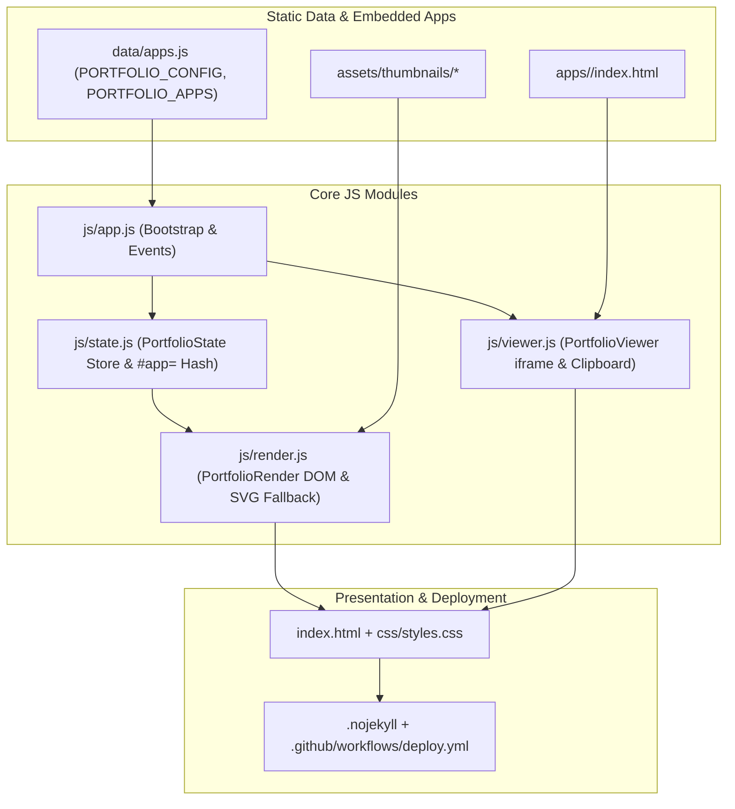

# Web App Portfolio System Implementation Plan

> **For agentic workers:** REQUIRED SUB-SKILL: Use superpowers:subagent-driven-development to implement this plan task-by-task. Steps use checkbox (`- [ ]`) syntax for tracking.

**Goal:** Build a zero-build static web app portfolio (`c:\Antigravity\portfolio`) that showcases each web app's purpose, target audience, usage content, and thumbnail, supports both external GitHub URLs and directly embedded local apps under `apps/`, and deploys cleanly to GitHub Pages or any static drop host.

**Architecture:** Pure HTML/CSS/Vanilla JS loaded via ordered `<script defer>` tags (`data/apps.js` → `js/state.js` → `js/render.js` → `js/viewer.js` → `js/app.js`) so both local `file://` previews and hosted `https://` subpaths work without a bundler or CORS failures. All asset and app paths use relative `./` URLs, DOM rendering uses `document.createElement` + `textContent` exclusively, and `.nojekyll` + `.github/workflows/deploy.yml` automate GitHub Pages deployment.

**Architecture Diagram:**



**Tech Stack:** HTML5, CSS3 (Custom Properties, Grid/Flexbox), Vanilla JavaScript (ES2020 without ES Module imports for `file://` compatibility), Node.js `v24.21.0` (`node:test` + `node:assert/strict` for automated verification), Python `http.server` + browser verification.

**Spec:** [2026-11-16-portfolio-system-design.md](file:///c:/Antigravity/portfolio/docs/superpowers/specs/2026-11-16-portfolio-system-design.md)

## Global Constraints

- **Zero build / zero external npm dependencies:** No bundler, no `package.json` runtime deps; tests use built-in `node --test`.
- **`file://` + subpath safety:** Never use `<script type="module">`, `fetch()` for core data, or root-absolute `/...` paths; use relative `./...` paths everywhere.
- **XSS-safe DOM rendering:** Never pass data strings from `PORTFOLIO_CONFIG` or `PORTFOLIO_APPS` into `innerHTML`; always use `document.createElement` and `textContent`.
- **Resource cleanup:** Closing the live viewer overlay MUST reset the `iframe` `src` to `"about:blank"`.
- **GitHub Pages readiness:** Include `.nojekyll` at repo root and `.github/workflows/deploy.yml` excluding `tests/` and `docs/` from the published Pages artifact if staging or uploading root web files cleanly.

---

### Task 1: Project Skeleton, Data Schema (`data/apps.js`), Sample Embedded App & GitHub Pages Workflow

**Files:**
- Create: `.nojekyll`
- Create: `.github/workflows/deploy.yml`
- Create: `data/apps.js`
- Create: `apps/sample-app/index.html`
- Create: `assets/thumbnails/sample-app.svg`
- Create: `assets/thumbnails/external-demo.svg`
- Create: `README.md`
- Test: `tests/data-schema.test.js`

**Interfaces:**
- Consumes: None (root data layer)
- Produces:
  - `window.PORTFOLIO_CONFIG = { siteTitle, siteSubtitle, ownerName, contactLink }`
  - `window.PORTFOLIO_APPS = Array<{ id, title, tagline, purpose, audience, description, thumbnail, launchType, url, embedMode, tags, featured, createdAt }>`

- [ ] **Step 1: Initialize git repository (local only, if not initialized) and write the failing schema test**

Create [tests/data-schema.test.js](file:///c:/Antigravity/portfolio/tests/data-schema.test.js):

```javascript
const test = require("node:test");
const assert = require("node:assert/strict");
const fs = require("node:fs");
const path = require("node:path");
const vm = require("node:vm");

const ROOT = path.resolve(__dirname, "..");

test("GitHub Pages config files (.nojekyll and deploy.yml) exist", () => {
  assert.equal(fs.existsSync(path.join(ROOT, ".nojekyll")), true);
  const workflowPath = path.join(ROOT, ".github", "workflows", "deploy.yml");
  assert.equal(fs.existsSync(workflowPath), true);
  const workflow = fs.readFileSync(workflowPath, "utf8");
  assert.match(workflow, /actions\/deploy-pages/);
  assert.match(workflow, /actions\/upload-pages-artifact/);
});

test("data/apps.js defines valid PORTFOLIO_CONFIG and PORTFOLIO_APPS", () => {
  const dataPath = path.join(ROOT, "data", "apps.js");
  assert.equal(fs.existsSync(dataPath), true);

  const sandbox = { window: {} };
  vm.runInNewContext(fs.readFileSync(dataPath, "utf8"), sandbox);

  const config = sandbox.window.PORTFOLIO_CONFIG;
  const apps = sandbox.window.PORTFOLIO_APPS;

  assert.equal(typeof config.siteTitle, "string");
  assert.ok(config.siteTitle.length > 0);
  assert.equal(typeof config.siteSubtitle, "string");
  assert.equal(typeof config.ownerName, "string");

  assert.ok(Array.isArray(apps));
  assert.ok(apps.length >= 2, "Expected at least 2 sample entries (external + embedded)");

  const ids = new Set();
  for (const app of apps) {
    assert.match(app.id, /^[a-z0-9-]+$/);
    assert.equal(ids.has(app.id), false, `Duplicate app id: ${app.id}`);
    ids.add(app.id);

    for (const field of ["title", "tagline", "purpose", "audience", "url"]) {
      assert.equal(typeof app[field], "string", `${app.id}.${field} must be a string`);
      assert.ok(app[field].trim().length > 0, `${app.id}.${field} must be non-empty`);
    }

    assert.ok(
      typeof app.description === "string" || Array.isArray(app.description),
      `${app.id}.description must be string or string[]`
    );
    assert.ok(["external", "embedded"].includes(app.launchType));
    assert.ok(["iframe", "newTab"].includes(app.embedMode));

    if (app.launchType === "embedded") {
      assert.ok(app.url.startsWith("./apps/"), "Embedded app url must be relative ./apps/...");
      const targetFile = path.resolve(ROOT, app.url);
      assert.equal(fs.existsSync(targetFile), true, `Missing embedded file: ${app.url}`);
    }

    if (app.thumbnail && app.thumbnail.startsWith("./")) {
      const thumbFile = path.resolve(ROOT, app.thumbnail);
      assert.equal(fs.existsSync(thumbFile), true, `Missing thumbnail file: ${app.thumbnail}`);
    }
  }

  assert.ok(apps.some((a) => a.launchType === "embedded"));
  assert.ok(apps.some((a) => a.launchType === "external"));
});
```

- [ ] **Step 2: Run test to verify it fails**

Run: `node --test tests/data-schema.test.js`
Expected: FAIL because `.nojekyll`, `deploy.yml`, and `data/apps.js` do not exist yet.

- [ ] **Step 3: Create `.nojekyll`, `.github/workflows/deploy.yml`, thumbnails, sample embedded app, `data/apps.js`, and `README.md`**

Create `.nojekyll` (empty file).

Create `.github/workflows/deploy.yml`:

```yaml
name: Deploy Portfolio to GitHub Pages

on:
  push:
    branches: ["main"]
  workflow_dispatch:

permissions:
  contents: read
  pages: write
  id-token: write

concurrency:
  group: "pages"
  cancel-in-progress: false

jobs:
  deploy:
    environment:
      name: github-pages
      url: ${{ steps.deployment.outputs.page_url }}
    runs-on: ubuntu-latest
    steps:
      - name: Checkout
        uses: actions/checkout@v4

      - name: Stage static portfolio files
        run: |
          mkdir -p _site
          cp index.html .nojekyll _site/
          cp -r css js data assets apps _site/

      - name: Setup Pages
        uses: actions/configure-pages@v5

      - name: Upload artifact
        uses: actions/upload-pages-artifact@v3
        with:
          path: "_site"

      - name: Deploy to GitHub Pages
        id: deployment
        uses: actions/deploy-pages@v4
```

Create `assets/thumbnails/sample-app.svg` (16:9 `800x450` parametric SVG card preview):

```xml
<svg xmlns="http://www.w3.org/2000/svg" viewBox="0 0 800 450" role="img" aria-labelledby="thumb-sample-title">
  <title id="thumb-sample-title">포모도로 집중 타이머 샘플 앱 썸네일</title>
  <defs>
    <linearGradient id="bg-sample" x1="0%" y1="0%" x2="100%" y2="100%">
      <stop offset="0%" stop-color="#0f172a"/>
      <stop offset="100%" stop-color="#1e293b"/>
    </linearGradient>
    <linearGradient id="accent-sample" x1="0%" y1="0%" x2="100%" y2="0%">
      <stop offset="0%" stop-color="#38bdf8"/>
      <stop offset="100%" stop-color="#22c55e"/>
    </linearGradient>
  </defs>
  <rect width="800" height="450" fill="url(#bg-sample)"/>
  <circle cx="400" cy="215" r="110" fill="none" stroke="#334155" stroke-width="14"/>
  <circle cx="400" cy="215" r="110" fill="none" stroke="url(#accent-sample)" stroke-width="14" stroke-dasharray="518 691" stroke-linecap="round" transform="rotate(-90 400 215)"/>
  <text x="400" y="226" text-anchor="middle" fill="#f8fafc" font-family="system-ui, sans-serif" font-size="44" font-weight="700">25:00</text>
  <text x="400" y="380" text-anchor="middle" fill="#94a3b8" font-family="system-ui, sans-serif" font-size="20" font-weight="600">EMBEDDED APP · FOCUS TIMER</text>
</svg>
```

Create `assets/thumbnails/external-demo.svg` (16:9 `800x450` parametric SVG card preview):

```xml
<svg xmlns="http://www.w3.org/2000/svg" viewBox="0 0 800 450" role="img" aria-labelledby="thumb-ext-title">
  <title id="thumb-ext-title">외부 배포 웹앱 예시 썸네일</title>
  <defs>
    <linearGradient id="bg-ext" x1="0%" y1="0%" x2="100%" y2="100%">
      <stop offset="0%" stop-color="#1e1b4b"/>
      <stop offset="100%" stop-color="#312e81"/>
    </linearGradient>
  </defs>
  <rect width="800" height="450" fill="url(#bg-ext)"/>
  <rect x="140" y="75" width="520" height="300" rx="18" fill="#0f172a" stroke="#6366f1" stroke-width="2"/>
  <rect x="140" y="75" width="520" height="42" rx="18" fill="#1e293b"/>
  <circle cx="174" cy="96" r="6" fill="#f87171"/>
  <circle cx="196" cy="96" r="6" fill="#fbbf24"/>
  <circle cx="218" cy="96" r="6" fill="#34d399"/>
  <rect x="180" y="148" width="210" height="24" rx="6" fill="#818cf8"/>
  <rect x="180" y="190" width="440" height="14" rx="4" fill="#475569"/>
  <rect x="180" y="218" width="380" height="14" rx="4" fill="#475569"/>
  <rect x="180" y="268" width="140" height="44" rx="10" fill="#4f46e5"/>
  <text x="250" y="296" text-anchor="middle" fill="#ffffff" font-family="system-ui, sans-serif" font-size="16" font-weight="600">GITHUB LIVE</text>
</svg>
```

Create `apps/sample-app/index.html` (self-contained interactive 25-minute focus timer demonstrating direct embedded app without GitHub):

```html
<!DOCTYPE html>
<html lang="ko">
<head>
  <meta charset="UTF-8" />
  <meta name="viewport" content="width=device-width, initial-scale=1.0" />
  <title>샘플 내장 앱 - 25분 집중 타이머</title>
  <style>
    :root {
      color-scheme: dark;
      --bg: #0f172a;
      --card: #1e293b;
      --text: #f8fafc;
      --muted: #94a3b8;
      --accent: #38bdf8;
    }
    * { box-sizing: border-box; }
    body {
      margin: 0;
      min-height: 100vh;
      display: grid;
      place-items: center;
      background: var(--bg);
      color: var(--text);
      font-family: system-ui, -apple-system, sans-serif;
      padding: 1.5rem;
    }
    .panel {
      width: min(420px, 100%);
      background: var(--card);
      border: 1px solid #334155;
      border-radius: 16px;
      padding: 2rem;
      text-align: center;
    }
    .badge {
      display: inline-block;
      padding: 0.25rem 0.75rem;
      border-radius: 999px;
      background: rgba(56, 189, 248, 0.15);
      color: var(--accent);
      font-size: 0.8rem;
      font-weight: 600;
    }
    h1 { margin: 0.9rem 0 0.35rem; font-size: 1.35rem; }
    p { margin: 0 0 1.5rem; color: var(--muted); font-size: 0.95rem; }
    .time {
      font-size: 3.5rem;
      font-weight: 800;
      letter-spacing: 0.04em;
      font-variant-numeric: tabular-nums;
      margin: 1rem 0 1.5rem;
    }
    .actions { display: flex; gap: 0.75rem; justify-content: center; }
    button {
      border: 0;
      border-radius: 10px;
      padding: 0.7rem 1.25rem;
      font-size: 0.95rem;
      font-weight: 600;
      cursor: pointer;
    }
    .primary { background: var(--accent); color: #082f49; }
    .secondary { background: #334155; color: var(--text); }
  </style>
</head>
<body>
  <main class="panel">
    <span class="badge">포트폴리오 내장 앱 샘플</span>
    <h1>25분 집중 타이머</h1>
    <p>별도 GitHub 저장소 없이 <code>apps/sample-app/</code>에 직접 탑재된 웹앱 예시입니다.</p>
    <div id="display" class="time" aria-live="polite">25:00</div>
    <div class="actions">
      <button id="toggleBtn" class="primary" type="button">시작</button>
      <button id="resetBtn" class="secondary" type="button">초기화</button>
    </div>
  </main>
  <script>
    (function () {
      const DEFAULT_SECONDS = 25 * 60;
      let remaining = DEFAULT_SECONDS;
      let timerId = null;

      const display = document.getElementById("display");
      const toggleBtn = document.getElementById("toggleBtn");
      const resetBtn = document.getElementById("resetBtn");

      function render() {
        const min = String(Math.floor(remaining / 60)).padStart(2, "0");
        const sec = String(remaining % 60).padStart(2, "0");
        display.textContent = min + ":" + sec;
      }

      function stop() {
        if (timerId !== null) {
          clearInterval(timerId);
          timerId = null;
        }
        toggleBtn.textContent = "시작";
      }

      toggleBtn.addEventListener("click", function () {
        if (timerId !== null) {
          stop();
          return;
        }
        toggleBtn.textContent = "일시정지";
        timerId = setInterval(function () {
          if (remaining > 0) {
            remaining -= 1;
            render();
          } else {
            stop();
          }
        }, 1000);
      });

      resetBtn.addEventListener("click", function () {
        stop();
        remaining = DEFAULT_SECONDS;
        render();
      });

      render();
    })();
  </script>
</body>
</html>
```

Create `data/apps.js`:

```javascript
/**
 * 포트폴리오 설정 및 웹앱 목록 데이터 파일
 *
 * [새 웹앱 추가 방법]
 * 1) 기존 GitHub Pages 등 외부에 배포된 앱:
 *    - launchType: "external"
 *    - url: "https://username.github.io/my-app/"
 *    - embedMode: "iframe" (포트폴리오 안에서 바로 실행) 또는 "newTab" (외부 사이트가 iframe을 막을 때)
 *
 * 2) GitHub에 별도 배포하지 않고 바로 탑재하는 앱:
 *    - apps/<id>/ 폴더에 정적 웹앱 파일(index.html 등)을 복사
 *    - launchType: "embedded"
 *    - url: "./apps/<id>/index.html"
 *    - embedMode: "iframe"
 *
 * 3) 썸네일 이미지:
 *    - assets/thumbnails/ 폴더에 이미지를 넣고 "./assets/thumbnails/파일명.png" 형태로 지정 (16:9 권장)
 */

window.PORTFOLIO_CONFIG = {
  siteTitle: "My Web App Studio",
  siteSubtitle: "일상의 작은 불편을 해결하기 위해 직접 만든 웹앱들을 한곳에 모아 공유합니다.",
  ownerName: "제작자 이름",
  contactLink: ""
};

window.PORTFOLIO_APPS = [
  {
    id: "sample-focus-timer",
    title: "25분 집중 타이머 (내장 앱 샘플)",
    tagline: "GitHub 별도 배포 없이 포트폴리오 폴더에 바로 탑재해 실행하는 포모도로 타이머",
    purpose: "별도의 사이트나 저장소를 열지 않고도 포트폴리오 안에서 즉시 써볼 수 있는 내장 웹앱 구조를 검증하고 안내하기 위해 만들었습니다.",
    audience: "공부나 업무 중 간단하게 25분 집중 세션을 돌리고 싶은 사용자",
    description: [
      "시작 버튼을 누르면 25분 카운트다운이 시작되며, 언제든 일시정지와 초기화가 가능합니다.",
      "실제 내 앱을 추가할 때는 apps/<앱아이디>/ 폴더에 정적 파일을 넣고 data/apps.js에 등록하면 됩니다."
    ],
    thumbnail: "./assets/thumbnails/sample-app.svg",
    launchType: "embedded",
    url: "./apps/sample-app/index.html",
    embedMode: "iframe",
    tags: ["생산성", "타이머", "내장앱"],
    featured: true,
    createdAt: "2026-11-16"
  },
  {
    id: "github-deployed-example",
    title: "기존 GitHub 배포 웹앱 (예시 슬롯)",
    tagline: "이미 GitHub Pages 등에 배포되어 있는 내 웹앱의 목적·대상·사용법을 정리해 연결하는 예시",
    purpose: "여러 저장소에 흩어져 있던 기존 웹앱들을 한 화면에서 맥락과 함께 소개하고 지인에게 공유하기 위한 연결 슬롯입니다.",
    audience: "포트폴리오 링크 하나로 기존에 만든 웹앱들을 둘러보고 싶은 지인 및 사용자",
    description: [
      "이 항목의 url을 실제 GitHub Pages 주소(예: https://아이디.github.io/앱이름/)로 바꾸면 바로 내 앱이 연결됩니다.",
      "목적, 대상, 사용법 텍스트와 16:9 썸네일을 수정해 실제 앱 소개로 교체하세요."
    ],
    thumbnail: "./assets/thumbnails/external-demo.svg",
    launchType: "external",
    url: "https://example.com",
    embedMode: "newTab",
    tags: ["쇼케이스", "유틸리티"],
    featured: false,
    createdAt: "2026-11-16"
  }
];
```

Create `README.md` with clear Korean instructions for adding apps (both external GitHub URLs and direct `apps/<id>/` embedding), local testing, GitHub Pages automatic deploy, and GitHub-less static drop deploy.

- [ ] **Step 4: Run test to verify it passes**

Run: `node --test tests/data-schema.test.js`
Expected: PASS

- [ ] **Step 5: Initialize git repo (if not yet initialized) and commit Task 1**

Run: `git init -b main && git add .nojekyll .github/workflows/deploy.yml data/apps.js apps/sample-app/index.html assets/thumbnails/sample-app.svg assets/thumbnails/external-demo.svg README.md tests/data-schema.test.js && git commit -m "feat: add portfolio skeleton, data schema, sample embedded app, and GitHub Pages workflow"`

---

### Task 2: State, Filtering & Deep-Link Module (`js/state.js`)

**Files:**
- Create: `js/state.js`
- Test: `tests/state.test.js`

**Interfaces:**
- Consumes: `Array<AppEntry>` passed into `createStore(apps)`
- Produces: `window.PortfolioState` with:
  - `createStore(apps)`:
    - `getState()` -> `{ apps, searchQuery, activeTag, launchFilter, selectedAppId, viewerOpen, previewDevice }`
    - `subscribe(listener)` -> returns `unsubscribe()` function
    - `setSearchQuery(query)`
    - `setActiveTag(tag)` (`"all"` or tag string)
    - `setLaunchFilter(filter)` (`"all" | "embedded" | "external"`)
    - `resetFilters()`
    - `openDetail(appId)`
    - `closeDetail()`
    - `openViewer(appId)`
    - `closeViewer()`
    - `setPreviewDevice(device)` (`"desktop" | "mobile"`)
    - `getFilteredApps()` -> filtered array (`featured` items first, preserving original order within ties)
    - `getAllTags()` -> sorted unique tags across all apps
    - `getSelectedApp()` -> matching app object or `null`
    - `syncFromHash(hashString)` -> parses `#app=<id>`, sets `selectedAppId` if valid (else `null`), closes viewer if invalid
    - `buildShareUrl(baseHref, appId)` -> returns URL with `#app=<id>`

- [ ] **Step 1: Write the failing test**

Create [tests/state.test.js](file:///c:/Antigravity/portfolio/tests/state.test.js):

```javascript
const test = require("node:test");
const assert = require("node:assert/strict");
const fs = require("node:fs");
const path = require("node:path");
const vm = require("node:vm");

function loadStateModule() {
  const code = fs.readFileSync(path.resolve(__dirname, "..", "js", "state.js"), "utf8");
  const sandbox = { window: {} };
  vm.runInNewContext(code, sandbox);
  return sandbox.window.PortfolioState;
}

const SAMPLE_APPS = [
  {
    id: "app-one",
    title: "습관 트래커",
    tagline: "매일 루틴 기록",
    purpose: "꾸준한 습관 형성을 돕기 위해 제작",
    audience: "직장인 및 학생",
    description: ["체크리스트 기능"],
    launchType: "external",
    url: "https://example.com/1",
    embedMode: "newTab",
    tags: ["생산성", "건강"],
    featured: false
  },
  {
    id: "app-two",
    title: "색상 팔레트 생성기",
    tagline: "웹 디자인 배색 추천",
    purpose: "디자이너의 배색 고민 단축",
    audience: "프론트엔드 개발자",
    description: ["HEX 복사 기능"],
    launchType: "embedded",
    url: "./apps/app-two/index.html",
    embedMode: "iframe",
    tags: ["디자인", "생산성"],
    featured: true
  }
];

test("filters apps by searchQuery across title, purpose, audience, and tags", () => {
  const { createStore } = loadStateModule();
  const store = createStore(SAMPLE_APPS);

  // Featured comes first by default
  assert.deepEqual(store.getFilteredApps().map((a) => a.id), ["app-two", "app-one"]);

  store.setSearchQuery("습관");
  assert.deepEqual(store.getFilteredApps().map((a) => a.id), ["app-one"]);

  store.setSearchQuery("프론트엔드");
  assert.deepEqual(store.getFilteredApps().map((a) => a.id), ["app-two"]);

  store.resetFilters();
  assert.equal(store.getFilteredApps().length, 2);
});

test("filters apps by activeTag and launchFilter", () => {
  const { createStore } = loadStateModule();
  const store = createStore(SAMPLE_APPS);

  assert.deepEqual(store.getAllTags(), ["건강", "디자인", "생산성"]);

  store.setActiveTag("생산성");
  assert.equal(store.getFilteredApps().length, 2);

  store.setLaunchFilter("embedded");
  assert.deepEqual(store.getFilteredApps().map((a) => a.id), ["app-two"]);
});

test("manages detail modal, viewer overlay, and #app=<id> deep links", () => {
  const { createStore } = loadStateModule();
  const store = createStore(SAMPLE_APPS);

  let notifications = 0;
  const unsub = store.subscribe(() => { notifications += 1; });

  store.syncFromHash("#app=app-one");
  assert.equal(store.getState().selectedAppId, "app-one");
  assert.equal(store.getSelectedApp().title, "습관 트래커");

  store.openViewer("app-two");
  assert.equal(store.getState().selectedAppId, "app-two");
  assert.equal(store.getState().viewerOpen, true);

  store.setPreviewDevice("mobile");
  assert.equal(store.getState().previewDevice, "mobile");

  store.closeViewer();
  assert.equal(store.getState().viewerOpen, false);

  store.closeDetail();
  assert.equal(store.getState().selectedAppId, null);

  store.syncFromHash("#app=unknown-id");
  assert.equal(store.getState().selectedAppId, null);

  const shareUrl = store.buildShareUrl("https://me.github.io/portfolio/#old", "app-two");
  assert.equal(shareUrl, "https://me.github.io/portfolio/#app=app-two");

  assert.ok(notifications >= 6);
  unsub();
});
```

- [ ] **Step 2: Run test to verify it fails**

Run: `node --test tests/state.test.js`
Expected: FAIL (`Cannot find module` / `ENOENT` for `js/state.js`).

- [ ] **Step 3: Implement `js/state.js`**

Write `js/state.js` exposing `window.PortfolioState = { createStore }` implementing all state methods cleanly with immutable copies and listener notifications.

- [ ] **Step 4: Run test to verify it passes**

Run: `node --test tests/state.test.js`
Expected: PASS

- [ ] **Step 5: Commit Task 2**

Run: `git add js/state.js tests/state.test.js && git commit -m "feat: add portfolio state store, filtering, and hash deep-link handling"`

---

### Task 3: Safe DOM Rendering & Fallback Thumbnail Module (`js/render.js`)

**Files:**
- Create: `js/render.js`
- Test: `tests/render.test.js`

**Interfaces:**
- Consumes:
  - `config` (`window.PORTFOLIO_CONFIG`)
  - `state` snapshot from `PortfolioState`
  - `callbacks` (`{ onSelectApp, onSelectTag, onResetFilters, onCloseDetail, onLaunchIframe, onCopyShare }`)
- Produces: `window.PortfolioRender` with:
  - `createFallbackSvgDataUri(title)` -> `data:image/svg+xml;charset=utf-8,...`
  - `renderHeader(rootEl, config, stats)` (`stats = { totalCount, embeddedCount, externalCount }`)
  - `renderFilters(containerEl, tags, state, callbacks)`
  - `renderAppGrid(gridEl, apps, state, callbacks)`
  - `renderDetailModal(modalEl, app, callbacks)`

- [ ] **Step 1: Write the failing test**

Create [tests/render.test.js](file:///c:/Antigravity/portfolio/tests/render.test.js) with a lightweight fake DOM factory (`createFakeDocument()`) verifying:
- `createFallbackSvgDataUri("<script>alert(1)</script>")` escapes XML special characters and returns a valid `data:image/svg+xml` URI.
- `renderAppGrid` renders cards with `목적/대상` cues, badge (`직접 탑재` vs `웹 링크`), thumbnail `src` or fallback SVG, and renders an empty state with reset button when `apps` is empty.
- `renderDetailModal` renders the 3 required content headings (**이 앱의 목적**, **추천 대상**, **주요 내용 및 사용법**), XSS-safe `textContent` for `<script>` payloads (never raw HTML tags parsed), and correct primary CTA text (`포트폴리오에서 바로 실행` for `iframe` vs `새 탭에서 실행` for `newTab`).

- [ ] **Step 2: Run test to verify it fails**

Run: `node --test tests/render.test.js`
Expected: FAIL (`ENOENT` for `js/render.js`).

- [ ] **Step 3: Implement `js/render.js`**

Write `js/render.js` using `document.createElement` + `textContent` exclusively (no `innerHTML` on data strings), deterministic SVG fallback generator (`createFallbackSvgDataUri`), `img.onerror` guard (`dataset.fallbackApplied` to prevent infinite loop), and clean accessible buttons/ARIA attributes.

- [ ] **Step 4: Run test to verify it passes**

Run: `node --test tests/render.test.js`
Expected: PASS

- [ ] **Step 5: Commit Task 3**

Run: `git add js/render.js tests/render.test.js && git commit -m "feat: add XSS-safe DOM renderer, structured detail modal, and SVG thumbnail fallback"`

---

### Task 4: Live Viewer, App Bootstrap, HTML & Responsive Styling (`js/viewer.js`, `js/app.js`, `index.html`, `css/styles.css`)

**Files:**
- Create: `js/viewer.js`
- Create: `js/app.js`
- Create: `index.html`
- Create: `css/styles.css`
- Test: `tests/viewer-and-html.test.js`

**Interfaces:**
- Consumes: `window.PORTFOLIO_CONFIG`, `window.PORTFOLIO_APPS`, `window.PortfolioState`, `window.PortfolioRender`
- Produces:
  - `window.PortfolioViewer` (`mountViewer(overlayEl, app, previewDevice)`, `unmountViewer(overlayEl)`, `copyShareLink(url, onCopied)`)
  - `window.PortfolioApp` (`initPortfolio()`)

- [ ] **Step 1: Write the failing test**

Create [tests/viewer-and-html.test.js](file:///c:/Antigravity/portfolio/tests/viewer-and-html.test.js) testing:
- `PortfolioViewer.mountViewer` sets iframe `src`, `title`, and applies `"is-mobile"` class when `previewDevice === "mobile"`.
- `PortfolioViewer.unmountViewer` resets `iframe.src` to `"about:blank"` and hides the overlay (`hidden = true`).
- `PortfolioViewer.copyShareLink` invokes `navigator.clipboard.writeText(url)` and fires toast callback.
- `index.html` exists, loads scripts in strict dependency order (`./data/apps.js` → `./js/state.js` → `./js/render.js` → `./js/viewer.js` → `./js/app.js`) with `defer`, contains zero `<script type="module">` tags, and contains zero root-absolute `/css/`, `/js/`, `/data/`, `/assets/`, `/apps/` paths.

- [ ] **Step 2: Run test to verify it fails**

Run: `node --test tests/viewer-and-html.test.js`
Expected: FAIL (`ENOENT` for `js/viewer.js` and `index.html`).

- [ ] **Step 3: Implement `js/viewer.js`, `js/app.js`, `index.html`, and `css/styles.css`**

Build:
- `js/viewer.js`: clean viewer mount/unmount, device width class toggle, clipboard API + `execCommand("copy")` fallback for `file://` contexts.
- `js/app.js`: `DOMContentLoaded` bootstrap, wiring search input, launch filter pills, tag chips, modal close (`Escape` + backdrop), viewer controls, `hashchange` sync, and toast feedback.
- `index.html`: clean semantic layout (`header`, search/filter toolbar, `#app-grid`, `#detail-modal`, `#viewer-overlay`, `#toast`), all relative `./` paths, Open Graph tags for sharing the portfolio.
- `css/styles.css`: refined, modern editorial studio aesthetic (clean typography, subtle surface elevation, 16:9 thumbnail frames with smooth hover lift, crisp badge contrast, 1/2/3-column responsive grid, accessible focus rings, modal & full-screen viewer with 390px mobile frame, `@media (prefers-reduced-motion: reduce)`).

- [ ] **Step 4: Run full Node test suite**

Run: `node --test tests/*.test.js`
Expected: All tests across `data-schema.test.js`, `state.test.js`, `render.test.js`, and `viewer-and-html.test.js` PASS.

- [ ] **Step 5: Commit Task 4**

Run: `git add js/viewer.js js/app.js index.html css/styles.css tests/viewer-and-html.test.js && git commit -m "feat: add in-app iframe viewer, bootstrap wiring, HTML layout, and responsive styles"`

---

### Task 5: End-to-End Local Server & Browser Verification

**Files:**
- Verify: All runtime files (`index.html`, `css/styles.css`, `js/*.js`, `data/apps.js`, `assets/thumbnails/*.svg`, `apps/sample-app/index.html`)

- [ ] **Step 1: Run complete automated test suite**

Run: `node --test tests/*.test.js`
Expected: 100% pass, 0 failures.

- [ ] **Step 2: Serve locally with Python HTTP server and verify in browser**

Run background server: `python -m http.server 4173`
Verify via browser:
1. Initial showcase cards render with 16:9 thumbnails, `직접 탑재` / `웹 링크` badges, purpose/audience summary.
2. Search input filters cards live; tag chips and launch-type filters work; empty state + reset button restores all cards.
3. Clicking a card opens the detail modal with **이 앱의 목적**, **추천 대상**, **주요 내용 및 사용법**, and updates URL hash to `#app=<id>`.
4. Loading `#app=sample-focus-timer` directly opens the detail modal automatically.
5. Clicking `공유 링크 복사` shows toast feedback.
6. Clicking `포트폴리오에서 바로 실행` mounts `./apps/sample-app/index.html` inside the viewer overlay, `모바일` toggle resizes the frame to `390px`, the embedded 25-minute timer responds to clicks, and closing the viewer cleans up cleanly.
7. Mobile viewport (`390x844`) renders without horizontal overflow or clipped controls.

- [ ] **Step 3: Stop local server and confirm clean `git status`**

Run: `git status`
Expected: Clean working tree (no untracked temp files).

---

## Plan Self-Review

1. **Spec coverage:**
   - Purpose, Audience, Content, Thumbnail display → Task 1 (`data/apps.js`), Task 3 (`render.js`), Task 4 (`index.html`, `styles.css`).
   - Hybrid external GitHub URL + embedded `apps/<id>/` → Task 1 (`sample-app`), Task 2 (`launchFilter`), Task 4 (`viewer.js`).
   - Deep-link `#app=<id>` + share copy → Task 2 (`syncFromHash`, `buildShareUrl`), Task 4 (`copyShareLink`, `app.js`).
   - Fallback SVG thumbnail & `X-Frame-Options` new-tab escape → Task 3 (`createFallbackSvgDataUri`), Task 4 (`viewer.js` top bar).
   - GitHub Pages auto-deploy + relative `./` path safety → Task 1 (`.nojekyll`, `.github/workflows/deploy.yml`), Task 4 (`viewer-and-html.test.js`).
2. **Placeholder scan:** No TBD/TODO/unspecified logic; all file paths, test assertions, and module interfaces are concrete.
3. **Type/interface consistency:** `PORTFOLIO_CONFIG`, `PORTFOLIO_APPS`, `PortfolioState.createStore`, `PortfolioRender`, `PortfolioViewer`, `PortfolioApp` names and signatures match identically across Tasks 1–4.
