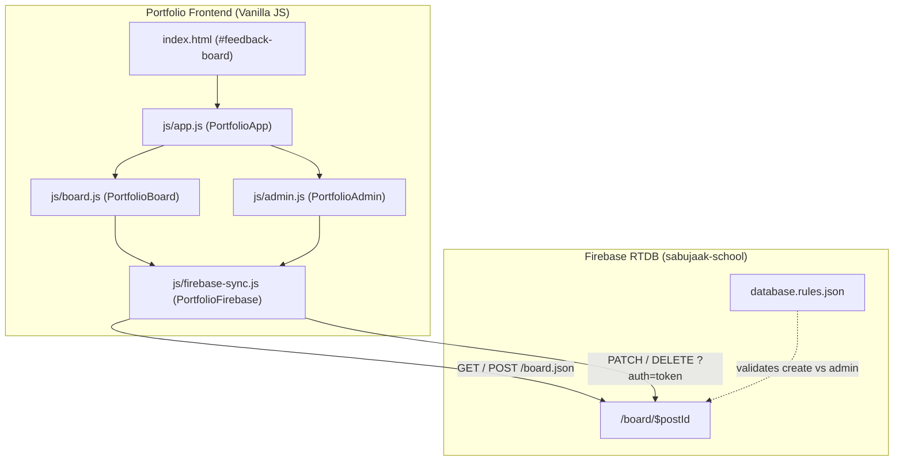

# 사부작스쿨 문의·건의·요청 게시판 Implementation Plan

> **For agentic workers:** REQUIRED SUB-SKILL: Use superpowers:subagent-driven-development to implement this plan task-by-task. Steps use checkbox (`- [ ]`) syntax for tracking.

**Goal:** 사부작스쿨 쇼케이스 하단에 방문자가 닉네임(선택)과 내용만으로 문의·건의·요청 글을 남기고 열람하며, 관리자가 답변·삭제할 수 있는 공개 게시판을 추가한다.

**Architecture:** 기존 정적 Vanilla JS IIFE 구조와 Firebase RTDB(`sabujaak-school`) 인프라를 확장한다. `js/firebase-sync.js`에 `/board` REST CRUD 헬퍼를 추가하고, 독립 UI/컨트롤러 모듈 `js/board.js`가 폼 검증·쿨다운·XSS 안전 렌더링(`textContent`)·페이지네이션·관리자 삭제/답변 인터랙션을 담당하며, `js/app.js`가 초기화 및 관리자 잠금 상태 동기화를 연결한다.

**Architecture Diagram:**

**Tech Stack:** HTML5, CSS3 (`css/styles.css`, `css/theme-craft.css`), Vanilla JS (ES5-compatible IIFE modules), Firebase Realtime Database REST API, Node.js `node --test` (`node:vm` + fake DOM harness).

**Spec:** [2026-11-29-feedback-board-design.md](file:///c:/Antigravity/portfolio/docs/superpowers/specs/2026-11-29-feedback-board-design.md)

## Global Constraints

- 순수 정적 Vanilla JS IIFE 모듈만 사용 (`<script type="module">` 및 루트 절대 경로 `/js/...` 금지).
- 모든 사용자 입력(`author`, `content`, `reply`)은 반드시 `textContent`로만 렌더링 (`innerHTML` 금지).
- `database.rules.json`의 비로그인 쓰기는 `!data.exists()` 생성 전용이며 `reply`/`replyAt` 위조를 차단해야 함.
- 관리자 UID(`zNS57lhTOXMCDrbBwhAV2US5i0w1`) 토큰 없이 삭제/답변 요청 금지.
- 기존 `node --test tests/*.test.js` 58개 테스트가 깨지지 않아야 함.

---

### Task 1: Firebase RTDB 보안 규칙 및 `/board` REST 동기화 헬퍼 추가

**Files:**
- Modify: `c:\Antigravity\portfolio\database.rules.json`
- Modify: `c:\Antigravity\portfolio\js\firebase-sync.js`
- Test: `c:\Antigravity\portfolio\tests\firebase-sync.test.js`

**Interfaces:**
- Consumes: `getFetch`, `normalizeDatabaseUrl`, `getValidIdToken`, `clearStoredSession` in `js/firebase-sync.js`
- Produces: `PortfolioFirebase.normalizeBoardPosts`, `PortfolioFirebase.loadBoardPosts`, `PortfolioFirebase.createBoardPost`, `PortfolioFirebase.replyBoardPost`, `PortfolioFirebase.deleteBoardPost`

- [ ] **Step 1: Write failing tests in `tests/firebase-sync.test.js`**
  - Test `normalizeBoardPosts` handles null/object/array, trims strings, defaults blank author to `"익명"`, drops malformed entries, sorts newest-first (`createdAt` desc, `id` desc tie-break).
  - Test `loadBoardPosts` fetches `/board.json` and returns normalized posts.
  - Test `createBoardPost` rejects < 2 chars or > 1000 chars, defaults empty author to `"익명"`, truncates author > 30 chars, sends `POST /board.json` without `reply`/`replyAt`, returns created post with server push key `name`.
  - Test `replyBoardPost` and `deleteBoardPost` validate `postId`, require valid Firebase auth token, send `PATCH` / `DELETE` to `/board/<id>.json?auth=...`, and handle `401/403` by clearing stored session and throwing Korean error.
- [ ] **Step 2: Run `node --test tests/firebase-sync.test.js` and verify new tests fail**
- [ ] **Step 3: Update `database.rules.json` with `/board` read/create/admin rules and implement the 5 methods in `js/firebase-sync.js`**
- [ ] **Step 4: Run `node --test tests/*.test.js` and verify all pass**
- [ ] **Step 5: Commit Task 1**

---

### Task 2: 게시판 UI & 컨트롤러 모듈 (`js/board.js`) 구현

**Files:**
- Create: `c:\Antigravity\portfolio\js\board.js`
- Test: `c:\Antigravity\portfolio\tests\board.test.js`

**Interfaces:**
- Consumes: `PortfolioFirebase.loadBoardPosts`, `PortfolioFirebase.createBoardPost`, `PortfolioFirebase.replyBoardPost`, `PortfolioFirebase.deleteBoardPost`, `PortfolioFirebase.getStoredAuth`
- Produces: `PortfolioBoard.createBoardController(options)` returning `{ refresh, setAdminUnlocked, destroy }`, plus `PortfolioBoard.formatPostTimestamp`

- [ ] **Step 1: Write failing tests in `tests/board.test.js`**
  - Verify initial render creates form (`#board-author`, `#board-content`, `#board-submit`), status area, post list, and triggers `loadBoardPosts`.
  - Verify empty author submits as `"익명"`, short content (`< 2` chars) shows validation error without calling `createBoardPost`, valid submission prepends new post cleanly.
  - Verify XSS payload `` in author/content/reply is set via `textContent` (zero HTML injection).
  - Verify rapid second submit within cooldown (`10000ms`) is blocked with Korean message, and works after cooldown expires.
  - Verify pagination (`pageSize = 5`): shows 5 posts + `"더 보기 (N건 남음)"` button, clicking reveals next batch.
  - Verify admin moderation: when `adminUnlocked` is false, delete/reply buttons are hidden; when true without Firebase auth token, clicking prompts Firebase login message; when true with auth token, 2-step delete removes post (`deleteBoardPost`) and inline reply form saves reply (`replyBoardPost`).
- [ ] **Step 2: Run `node --test tests/board.test.js` and verify it fails**
- [ ] **Step 3: Implement `c:\Antigravity\portfolio\js\board.js`**
- [ ] **Step 4: Run `node --test tests/*.test.js` and verify all pass**
- [ ] **Step 5: Commit Task 2**

---

### Task 3: `index.html`, `js/app.js`, CSS 통합 및 HTML/앱 통합 테스트

**Files:**
- Modify: `c:\Antigravity\portfolio\index.html`
- Modify: `c:\Antigravity\portfolio\js\app.js`
- Modify: `c:\Antigravity\portfolio\css\styles.css`
- Modify: `c:\Antigravity\portfolio\css\theme-craft.css`
- Modify: `c:\Antigravity\portfolio\tests\viewer-and-html.test.js`

**Interfaces:**
- Consumes: `PortfolioBoard.createBoardController`
- Produces: Integrated `#feedback-board` section wired with `PortfolioApp.initPortfolio()`, auth sync via `onAuthChanged`, and responsive craft theme styles.

- [ ] **Step 1: Add failing assertions in `tests/viewer-and-html.test.js`**
  - Verify `index.html` includes `./js/board.js` in script order before `./js/app.js` and contains `#feedback-board`.
  - Verify `PortfolioApp.initPortfolio` initializes `PortfolioBoard` when `#feedback-board` is present and updates `boardController.setAdminUnlocked` when `onAuthChanged` fires.
- [ ] **Step 2: Run `node --test tests/viewer-and-html.test.js` to confirm failure**
- [ ] **Step 3: Update `index.html`, `js/app.js`, `css/styles.css`, and `css/theme-craft.css`**
- [ ] **Step 4: Run `node --test tests/*.test.js` and verify full suite passes**
- [ ] **Step 5: Commit Task 3**

---

### Task 4: Firebase 규칙 배포, GitHub Pages 배포 및 라이브 브라우저 검증

**Files:**
- Live Firebase RTDB: `database.rules.json` -> `sabujaak-school`
- GitHub Pages: `origin main`

- [ ] **Step 1: Deploy `database.rules.json` with `firebase.cmd deploy --only database --project sabujaak-school`**
- [ ] **Step 2: Push `main` and watch GitHub Actions deployment**
- [ ] **Step 3: Verify live page (`https://baekbeom99-dotcom.github.io/portfolio/`) via browser subagent (desktop `1280x800` & mobile `390x844`): post creation, persistence across reload, console/network 0 errors, then delete test post from RTDB and capture clean final screenshot.**
